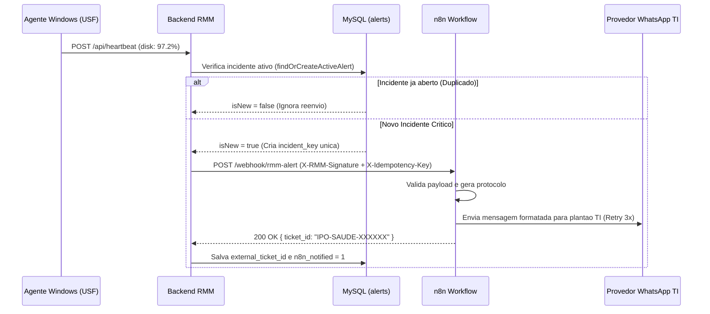

# Documentação de Automações n8n e Integração WhatsApp — RMM Ipojuca

**Ciclo:** #01  
**Fase:** FASE 8 — Automações e Notificações  
**Responsável:** `@n8n`  
**Skills Consultadas:** `.agents/skills/n8n/workflow_automation.md`, `.agents/skills/n8n/whatsapp_integration.md`

---

## 1. Visão Geral do Fluxo Autônomo (Inovação B)

Quando o Backend (`backend/src/routes/api.js`) detecta que um computador de uma Unidade de Saúde entrou em estado **`CRITICAL`** (ex.: Disco $\ge$ 95%, CPU $\ge$ 95%, RAM $\ge$ 95% ou Temperatura $\ge$ 85°C), ele aciona o serviço `triggerN8nIncidentWebhook` (`backend/src/services/n8nWebhookService.js`).



---

## 2. Prevenção de Duplicidade e Idempotência

Para evitar tempestades de notificações no WhatsApp da equipe de TI a cada ciclo de 30 segundos do heartbeat:
1. **Desduplicação Primária no Backend/Banco:** O método `repository.findOrCreateActiveAlert` consulta se já existe um alerta com status `OPEN` ou `ACKNOWLEDGED` para o mesmo `machine_id` e `metric_name`. O webhook do n8n **só é disparado na transição inicial** (`isNew === true`).
2. **Chave de Idempotência no Header HTTP:** Toda requisição ao n8n inclui o cabeçalho `X-Idempotency-Key: inc_<machine_id>_<metric>_<timestamp>` e assinatura HMAC-SHA256 em `X-RMM-Signature`.
3. **Auto-Resolução:** Quando a máquina volta ao estado `NORMAL` (após limpeza de disco ou manutenção remota), o backend marca os alertas abertos daquela máquina como `RESOLVED`.

---

## 3. Formato da Mensagem WhatsApp (LGPD-Compliant)

A mensagem enviada ao grupo/plantão da TI contém exclusivamente metadados operacionais da estação de trabalho, sem expor qualquer dado de paciente ou usuário:

```text
🚨 *[RMM SAÚDE IPOJUCA - ALERTA MACHINE_CRITICAL]*
🏥 *Unidade:* USF Nossa Senhora do Ó (USF)
📍 *Setor:* Consultório Médico 01
💻 *Equipamento:* USF-NSO-CONS01 (10.14.1.21)
⚠️ *Diagnóstico:* Uso de disco crítico em 96.8% (limite: 95%)
📊 *Métricas:* CPU 97.2% | RAM 89.4% | HD 96.8%
🎫 *Chamado Aberto:* #IPO-SAUDE-849201
🔗 *Acesso 3D:* http://localhost:5173/?machineId=103
```

---

## 4. Tratamento de Falhas e Retentativas

- **No n8n (`infrastructure/n8n/rmm_whatsapp_ticket_workflow.json`):** O nó `Notificar Equipe TI no WhatsApp` está configurado com `retryOnFail: true`, `maxTries: 3` e `waitBetweenTries: 3000` (3 segundos).
- **No Backend (`backend/src/services/n8nWebhookService.js`):** Se o serviço externo do n8n estiver temporariamente inacessível, o erro é capturado de forma resiliente (sem derrubar o processamento do heartbeat do agente) e o incidente recebe um identificador de fila (`TCK-QUEUE-<id>`) para reprocessamento.

