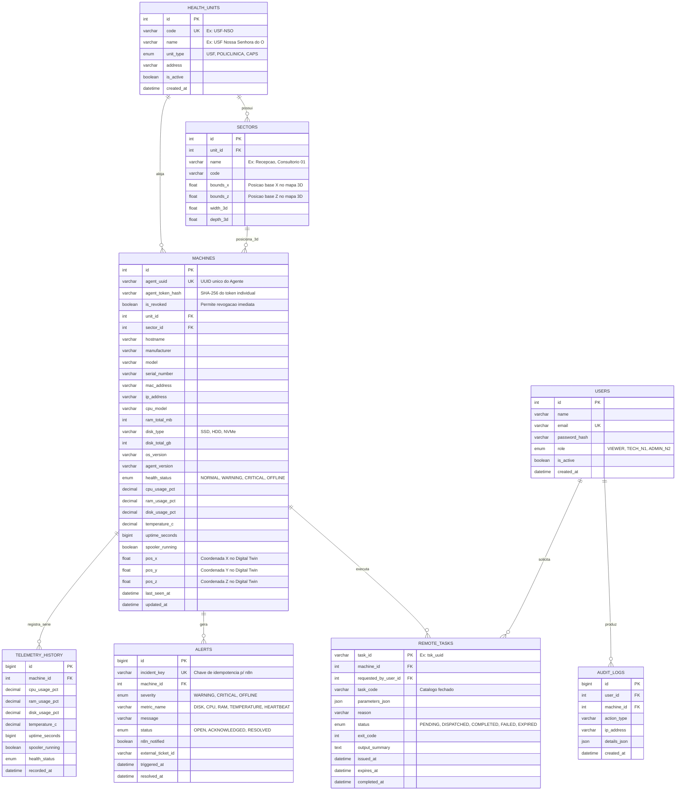

# Modelagem do Banco de Dados e Estratégia de Performance MySQL — RMM Ipojuca

**Ciclo:** #01  
**Fase:** FASE 4 — Modelagem do Banco de Dados  
**Responsável:** `@dba`  
**Skills Consultadas:** `.agents/skills/dba/data_modeling.md`, `.agents/skills/dba/database_performance.md`

---

## 1. Modelo Entidade-Relacionamento (ER)

A modelagem foi projetada para separar **estado quente** (consultado continuamente pelo Digital Twin 3D na tabela `machines`) de **séries temporais históricas** (`telemetry_history`) e **trilhas de auditoria** (`remote_tasks`, `alerts`, `audit_logs`).

---

## 2. Estratégia de Indexação e Performance (`database_performance.md`)

1. **Leitura O(1) para o Digital Twin 3D:**
   - A tabela `machines` armazena as métricas mais recentes (`cpu_usage_pct`, `ram_usage_pct`, `disk_usage_pct`, `health_status`, `last_seen_at`) junto às coordenadas espaciais (`pos_x`, `pos_y`, `pos_z`).
   - Dessa forma, o carregamento do mapa 3D de uma Unidade (`SELECT * FROM machines WHERE unit_id = ?`) **não realiza `JOIN` nem `GROUP BY` na tabela de histórico de telemetria**, garantindo latência inferior a 5 ms.
2. **Índices Compostos Estratégicos:**
   - `idx_machines_unit_status (unit_id, health_status)`: acelera os filtros e contadores do dashboard por unidade.
   - `idx_machines_last_seen (health_status, last_seen_at)`: permite ao *worker* de detecção de máquinas `OFFLINE` localizar agentes silenciosos sem *full table scan*.
   - `idx_telemetry_machine_time (machine_id, recorded_at DESC)`: otimiza a abertura da gaveta de diagnóstico com as últimas leituras de um computador específico.
   - `idx_alerts_machine_status (machine_id, status, metric_name)`: garante verificação rápida de desduplicação antes de acionar o Webhook do n8n.

---

## 3. Política de Retenção, Expurgo e Backups

- **Retenção de Telemetria (`telemetry_history`):**
  - Mantém granularidade completa por **30 dias**.
  - Job diário de manutenção remove registros com `recorded_at < NOW() - INTERVAL 30 DAY` em lotes (`LIMIT 10000`) para evitar bloqueio de tabela (*table lock*).
- **Retenção de Auditoria (`audit_logs` e `remote_tasks`):**
  - Mantida por **180 dias** para rastreabilidade administrativa e conformidade com auditorias de segurança.
- **Estratégia de Backup:**
  - Dump lógico diário automatizado (`mysqldump --single-transaction --routines --triggers`) comprimido em `.sql.gz` com retenção rotativa de 14 dias locais e cópia externa.

---

## 4. Script de Migration e Seed Inicial

O script SQL completo de criação do banco, tabelas, índices e dados iniciais das unidades de saúde de Ipojuca encontra-se versionado em:
- `infrastructure/mysql/01_schema_and_seed.sql`

