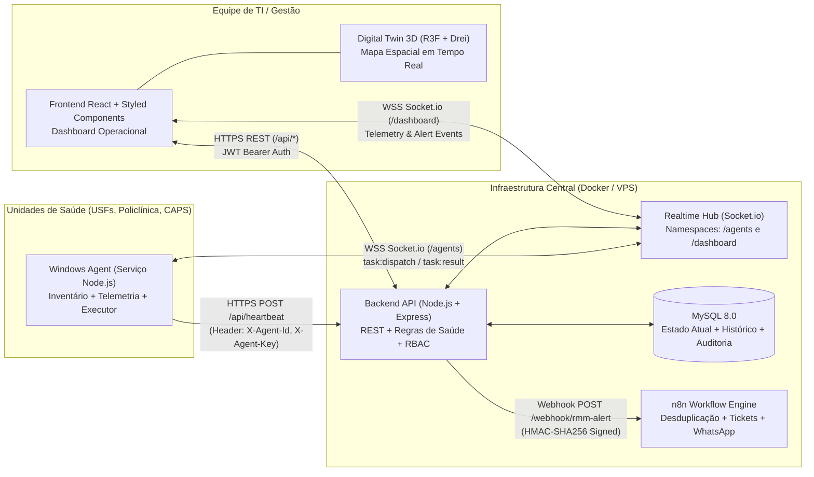

# Arquitetura do Sistema e Orquestração Técnica — RMM Ipojuca

**Ciclo:** #01  
**Fase:** FASE 2 — Arquitetura e Orquestração  
**Responsável:** `@lead`  
**Skills Consultadas:** `.agents/skills/lead/system_architecture.md`, `.agents/skills/lead/technical_orchestration.md`

---

## 1. Visão Arquitetural e Diagrama de Componentes

O RMM Ipojuca adota uma arquitetura modular orientada a eventos e contratos bem definidos, separando estritamente coleta de endpoint (`agent/`), processamento central e tempo real (`backend/`), visualização 2D/3D (`frontend/`), persistência relacional (`MySQL`), automação externa (`n8n`) e infraestrutura conteinerizada (`infrastructure/`).



---

## 2. Organização de Diretórios do Projeto

Para respeitar o padrão oficial do `startcycle.md` e manter compatibilidade com os arquivos iniciais do repositório:

- `production_artifacts/`: Documentação técnica oficial de cada fase do ciclo.
- `backend/`: API Node.js + Express + Socket.io, modelos, serviços, middlewares de segurança e suíte de testes automatizados.
- `agent/`: Código-fonte modular do Serviço Windows (`IpojucaRMMService`), coletores de hardware/telemetria, cliente WebSocket e executor de catálogo de tarefas. *(O arquivo legado `agente/src/index.js` atuará como ponte de compatibilidade para `agent/src/index.js`)*.
- `frontend/`: Aplicação SPA em React, Styled Components e cena 3D em React Three Fiber / Drei.
- `infrastructure/`: Scripts SQL de inicialização/migrations (`infrastructure/mysql/`), workflows exportados do n8n (`infrastructure/n8n/`), configurações Nginx/TLS e scripts de backup.

---

## 3. Contratos de Integração REST (`backend/`)

### 3.1. Autenticação e Sessão de Operadores
- **`POST /api/auth/login`**
  - **Request:** `{ "email": "tecnico@ipojuca.pe.gov.br", "password": "..." }`
  - **Response `200 OK`:**
    ```json
    {
      "token": "eyJhbGciOiJIUzI1NiIs...",
      "user": {
        "id": 1,
        "name": "Carlos Silva",
        "email": "tecnico@ipojuca.pe.gov.br",
        "role": "TECH_N1"
      }
    }
    ```

### 3.2. Heartbeat e Telemetria do Agente Windows
- **`POST /api/heartbeat`**
  - **Headers Obrigatórios:**
    - `X-Agent-Uuid`: UUID persistente do equipamento
    - `X-Agent-Token`: Segredo individual do agente
  - **Request Payload:**
    ```json
    {
      "agent_version": "1.0.0",
      "collected_at": "2026-11-05T15:30:00.000Z",
      "inventory": {
        "hostname": "USF-CENTRO-REC01",
        "manufacturer": "Dell Inc.",
        "model": "OptiPlex 3080",
        "serial_number": "BR9X21A",
        "mac_address": "00:1A:2B:3C:4D:5E",
        "ip_address": "10.10.1.25",
        "cpu_model": "Intel Core i5-10500T",
        "ram_total_mb": 8192,
        "disk_type": "SSD",
        "disk_total_gb": 240,
        "os_version": "Windows 11 Pro 23H2"
      },
      "metrics": {
        "cpu_usage_pct": 42.5,
        "ram_usage_pct": 68.2,
        "disk_usage_pct": 54.0,
        "temperature_c": 58.0,
        "uptime_seconds": 86400,
        "spooler_running": true
      }
    }
    ```
  - **Response `200 OK`:**
    ```json
    {
      "status": "ok",
      "machine_id": 101,
      "health_status": "NORMAL",
      "server_time": "2026-11-05T15:30:00.120Z"
    }
    ```

### 3.3. Consulta de Unidades, Máquinas e Digital Twin
- **`GET /api/units`**: Lista todas as unidades de saúde (USFs, Policlínica, CAPS), seus setores e contadores agregados de máquinas (`NORMAL`, `WARNING`, `CRITICAL`, `OFFLINE`).
- **`GET /api/machines?unit_id=1&sector_id=2&status=CRITICAL`**: Lista equipamentos com estado atual, coordenadas espaciais 3D (`pos_x`, `pos_y`, `pos_z`) e última telemetria.
- **`GET /api/machines/:id/diagnostics`**: Retorna inventário detalhado, série histórica recente de telemetria (últimas leituras), alertas abertos e histórico de tarefas remotas.

### 3.4. Execução de Tarefas Remotas Homologadas
- **`POST /api/command`**
  - **Auth:** `Bearer <JWT>` (Perfis `TECH_N1` ou `ADMIN_N2`, conforme nível de risco da tarefa).
  - **Request Payload:**
    ```json
    {
      "machine_id": 101,
      "task_code": "CLEAR_TEMP_CACHE",
      "parameters": {
        "include_system_temp": true
      },
      "reason": "Disco próximo ao limite de alerta na recepção"
    }
    ```
  - **Catálogo Oficial de `task_code` Permitidos:**
    1. `CLEAR_TEMP_CACHE` (Risco: `LOW` — Perfil mínimo: `TECH_N1`)
    2. `RESTART_SPOOLER` (Risco: `LOW` — Perfil mínimo: `TECH_N1`)
    3. `COLLECT_NETWORK_DIAG` (Risco: `LOW` — Perfil mínimo: `TECH_N1`)
    4. `CHECK_DISK_HEALTH` (Risco: `MEDIUM` — Perfil mínimo: `TECH_N1`)
    5. `INSTALL_APPROVED_PRINTER` (Risco: `HIGH` — Perfil mínimo: `ADMIN_N2`, valida driver/IP em whitelist)
    6. `FLUSH_DNS_WINSOCK` (Risco: `MEDIUM` — Perfil mínimo: `TECH_N1`)
  - **Response `202 Accepted`:**
    ```json
    {
      "task_id": "tsk_9f8e7d6c-1234",
      "status": "DISPATCHED",
      "machine_id": 101,
      "task_code": "CLEAR_TEMP_CACHE",
      "expires_at": "2026-11-05T15:32:00.000Z"
    }
    ```

---

## 4. Contratos de Eventos WebSocket (`Socket.io`)

### 4.1. Namespace `/agents` (Comunicação Backend ↔ Agente Windows)
- **Handshake Auth:** `{ agentUuid, agentToken }`
- **Evento Servidor → Agente (`task:execute`):**
  ```json
  {
    "task_id": "tsk_9f8e7d6c-1234",
    "task_code": "CLEAR_TEMP_CACHE",
    "parameters": { "include_system_temp": true },
    "issued_at": "2026-11-05T15:30:10.000Z",
    "expires_at": "2026-11-05T15:32:10.000Z",
    "signature": "sha256_hmac_signature"
  }
  ```
- **Evento Agente → Servidor (`task:result`):**
  ```json
  {
    "task_id": "tsk_9f8e7d6c-1234",
    "status": "COMPLETED",
    "exit_code": 0,
    "output_summary": "Removidos 412 MB de arquivos temporários.",
    "completed_at": "2026-11-05T15:30:14.200Z"
  }
  ```

### 4.2. Namespace `/dashboard` (Comunicação Backend ↔ Frontend/Digital Twin)
- **Handshake Auth:** `{ token: "<JWT>" }`
- **Eventos Servidor → Frontend:**
  - `machine:updated`: Payload enxuto com estado atual da máquina e métricas recém-recebidas (atualiza tabela e cor/pulsação do avatar 3D sem recarregar a página).
  - `alert:triggered`: Novo alerta crítico ou máquina offline detectada.
  - `task:updated`: Mudança de status de uma tarefa remota (`DISPATCHED` → `RUNNING` → `COMPLETED` / `FAILED`).

---

## 5. Contrato de Webhook com o n8n

- **Endpoint Destino:** `POST ${N8N_WEBHOOK_URL}`
- **Headers:** `X-RMM-Signature: sha256=<hmac>`, `X-Idempotency-Key: inc_<incident_id>`
- **Payload:**
  ```json
  {
    "incident_id": "inc_20261105_0042",
    "event_type": "MACHINE_CRITICAL",
    "occurred_at": "2026-11-05T15:30:00.000Z",
    "unit": {
      "id": 1,
      "name": "USF Nossa Senhora do Ó",
      "type": "USF"
    },
    "sector": {
      "id": 3,
      "name": "Consultório Médico 02"
    },
    "machine": {
      "id": 101,
      "hostname": "USF-NSO-CONS02",
      "ip_address": "10.20.4.18",
      "health_status": "CRITICAL"
    },
    "reason": "Uso de disco atingiu 96.4% (Limite crítico: 95%)",
    "metrics": {
      "cpu_usage_pct": 35.0,
      "ram_usage_pct": 71.0,
      "disk_usage_pct": 96.4,
      "temperature_c": 61.0
    },
    "dashboard_url": "https://rmm.ipojuca.pe.gov.br/machines/101"
  }
  ```

---

## 6. Sequência de Desenvolvimento e Riscos Arquiteturais

### 6.1. Ordem de Execução e Dependências
1. **Fase 3 (`@security`):** Validação do modelo de ameaças STRIDE e controles de autenticação/execução remota.
2. **Fase 4 (`@dba`):** Criação do schema relacional MySQL com separação entre tabela de estado atual (`machines`) e série temporal (`telemetry_logs`).
3. **Fase 5 (`@designer`):** Especificação do Design System e layout operacional/3D.
4. **Fase 6 (`@engineer`):** Implementação do Backend e do Agente Windows seguindo os contratos REST/Socket.io acima.
5. **Fase 7 (`@frontend`):** Implementação do Dashboard e do Digital Twin 3D consumindo a API e o Socket.io.
6. **Fase 8 (`@n8n`):** Construção do workflow de chamados e WhatsApp.
7. **Fases 9 e 10 (`@qa` & `@security`):** Testes automatizados e auditoria final.
8. **Fase 11 (`@devops`):** Conteinerização Docker e guia de implantação.

### 6.2. Mitigação de Riscos Arquiteturais
- **Risco de Sobrecarga no Banco por Telemetria:** Mitigado pela separação física entre a tabela `machines` (1 linha por computador com o estado atual e coordenadas 3D para leitura instantânea) e `telemetry_history` (inserção indexada por `machine_id, recorded_at` com expurgo automático após 30 dias).
- **Risco de Perda de Performance 3D em PCs Modestos:** Mitigado pelo uso de geometrias low-poly instanciadas/declarativas no React Three Fiber e renderização condicional por Unidade selecionada.

