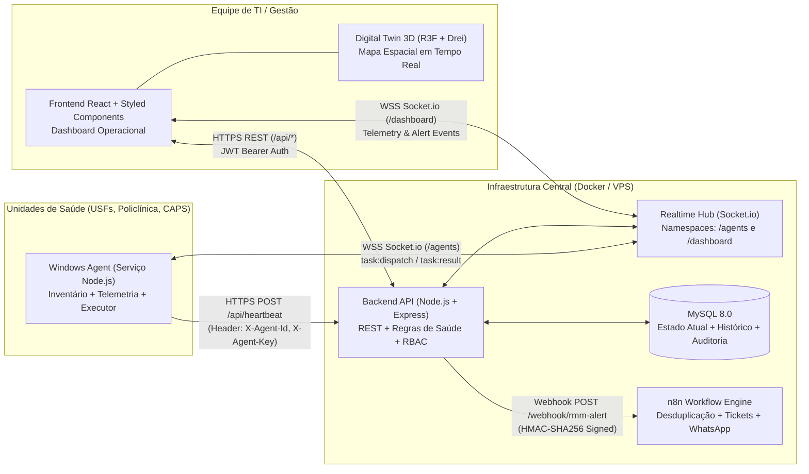

# Arquitetura do Sistema e Orquestração Técnica — RMM Ipojuca

**Ciclo:** #01  
**Fase:** FASE 2 — Arquitetura e Orquestração  
**Responsável:** `@lead`  
**Skills Consultadas:** `.agents/skills/lead/system_architecture.md`, `.agents/skills/lead/technical_orchestration.md`

---

## 1. Visão Arquitetural e Diagrama de Componentes

O RMM Ipojuca adota uma arquitetura modular orientada a eventos e contratos bem definidos, separando estritamente coleta de endpoint (`agent/`), processamento central e tempo real (`backend/`), visualização 2D/3D (`frontend/`), persistência relacional (`MySQL`), automação externa (`n8n`) e infraestrutura conteinerizada (`infrastructure/`).



---

## 2. Organização de Diretórios do Projeto

Para respeitar o padrão oficial do `startcycle.md` e manter compatibilidade com os arquivos iniciais do repositório:

- `production_artifacts/`: Documentação técnica oficial de cada fase do ciclo.
- `backend/`: API Node.js + Express + Socket.io, modelos, serviços, middlewares de segurança e suíte de testes automatizados.
- `agent/`: Código-fonte modular do Serviço Windows (`IpojucaRMMService`), coletores de hardware/telemetria, cliente WebSocket e executor de catálogo de tarefas. *(O arquivo legado `agente/src/index.js` atuará como ponte de compatibilidade para `agent/src/index.js`)*.
- `frontend/`: Aplicação SPA em React, Styled Components e cena 3D em React Three Fiber / Drei.
- `infrastructure/`: Scripts SQL de inicialização/migrations (`infrastructure/mysql/`), workflows exportados do n8n (`infrastructure/n8n/`), configurações Nginx/TLS e scripts de backup.

---

## 3. Contratos de Integração REST (`backend/`)

### 3.1. Autenticação e Sessão de Operadores
- **`POST /api/auth/login`**
  - **Request:** `{ "email": "tecnico@ipojuca.pe.gov.br", "password": "..." }`
  - **Response `200 OK`:**
    ```json
    {
      "token": "eyJhbGciOiJIUzI1NiIs...",
      "user": {
        "id": 1,
        "name": "Carlos Silva",
        "email": "tecnico@ipojuca.pe.gov.br",
        "role": "TECH_N1"
      }
    }
    ```

### 3.2. Heartbeat e Telemetria do Agente Windows
- **`POST /api/heartbeat`**
  - **Headers Obrigatórios:**
    - `X-Agent-Uuid`: UUID persistente do equipamento
    - `X-Agent-Token`: Segredo individual do agente
  - **Request Payload:**
    ```json
    {
      "agent_version": "1.0.0",
      "collected_at": "2026-11-05T15:30:00.000Z",
      "inventory": {
        "hostname": "USF-CENTRO-REC01",
        "manufacturer": "Dell Inc.",
        "model": "OptiPlex 3080",
        "serial_number": "BR9X21A",
        "mac_address": "00:1A:2B:3C:4D:5E",
        "ip_address": "10.10.1.25",
        "cpu_model": "Intel Core i5-10500T",
        "ram_total_mb": 8192,
        "disk_type": "SSD",
        "disk_total_gb": 240,
        "os_version": "Windows 11 Pro 23H2"
      },
      "metrics": {
        "cpu_usage_pct": 42.5,
        "ram_usage_pct": 68.2,
        "disk_usage_pct": 54.0,
        "temperature_c": 58.0,
        "uptime_seconds": 86400,
        "spooler_running": true
      }
    }
    ```
  - **Response `200 OK`:**
    ```json
    {
      "status": "ok",
      "machine_id": 101,
      "health_status": "NORMAL",
      "server_time": "2026-11-05T15:30:00.120Z"
    }
    ```

### 3.3. Consulta de Unidades, Máquinas e Digital Twin
- **`GET /api/units`**: Lista todas as unidades de saúde (USFs, Policlínica, CAPS), seus setores e contadores agregados de máquinas (`NORMAL`, `WARNING`, `CRITICAL`, `OFFLINE`).
- **`GET /api/machines?unit_id=1&sector_id=2&status=CRITICAL`**: Lista equipamentos com estado atual, coordenadas espaciais 3D (`pos_x`, `pos_y`, `pos_z`) e última telemetria.
- **`GET /api/machines/:id/diagnostics`**: Retorna inventário detalhado, série histórica recente de telemetria (últimas leituras), alertas abertos e histórico de tarefas remotas.

### 3.4. Execução de Tarefas Remotas Homologadas
- **`POST /api/command`**
  - **Auth:** `Bearer <JWT>` (Perfis `TECH_N1` ou `ADMIN_N2`, conforme nível de risco da tarefa).
  - **Request Payload:**
    ```json
    {
      "machine_id": 101,
      "task_code": "CLEAR_TEMP_CACHE",
      "parameters": {
        "include_system_temp": true
      },
      "reason": "Disco próximo ao limite de alerta na recepção"
    }
    ```
  - **Catálogo Oficial de `task_code` Permitidos:**
    1. `CLEAR_TEMP_CACHE` (Risco: `LOW` — Perfil mínimo: `TECH_N1`)
    2. `RESTART_SPOOLER` (Risco: `LOW` — Perfil mínimo: `TECH_N1`)
    3. `COLLECT_NETWORK_DIAG` (Risco: `LOW` — Perfil mínimo: `TECH_N1`)
    4. `CHECK_DISK_HEALTH` (Risco: `MEDIUM` — Perfil mínimo: `TECH_N1`)
    5. `INSTALL_APPROVED_PRINTER` (Risco: `HIGH` — Perfil mínimo: `ADMIN_N2`, valida driver/IP em whitelist)
    6. `FLUSH_DNS_WINSOCK` (Risco: `MEDIUM` — Perfil mínimo: `TECH_N1`)
  - **Response `202 Accepted`:**
    ```json
    {
      "task_id": "tsk_9f8e7d6c-1234",
      "status": "DISPATCHED",
      "machine_id": 101,
      "task_code": "CLEAR_TEMP_CACHE",
      "expires_at": "2026-11-05T15:32:00.000Z"
    }
    ```

---

## 4. Contratos de Eventos WebSocket (`Socket.io`)

### 4.1. Namespace `/agents` (Comunicação Backend ↔ Agente Windows)
- **Handshake Auth:** `{ agentUuid, agentToken }`
- **Evento Servidor → Agente (`task:execute`):**
  ```json
  {
    "task_id": "tsk_9f8e7d6c-1234",
    "task_code": "CLEAR_TEMP_CACHE",
    "parameters": { "include_system_temp": true },
    "issued_at": "2026-11-05T15:30:10.000Z",
    "expires_at": "2026-11-05T15:32:10.000Z",
    "signature": "sha256_hmac_signature"
  }
  ```
- **Evento Agente → Servidor (`task:result`):**
  ```json
  {
    "task_id": "tsk_9f8e7d6c-1234",
    "status": "COMPLETED",
    "exit_code": 0,
    "output_summary": "Removidos 412 MB de arquivos temporários.",
    "completed_at": "2026-11-05T15:30:14.200Z"
  }
  ```

### 4.2. Namespace `/dashboard` (Comunicação Backend ↔ Frontend/Digital Twin)
- **Handshake Auth:** `{ token: "<JWT>" }`
- **Eventos Servidor → Frontend:**
  - `machine:updated`: Payload enxuto com estado atual da máquina e métricas recém-recebidas (atualiza tabela e cor/pulsação do avatar 3D sem recarregar a página).
  - `alert:triggered`: Novo alerta crítico ou máquina offline detectada.
  - `task:updated`: Mudança de status de uma tarefa remota (`DISPATCHED` → `RUNNING` → `COMPLETED` / `FAILED`).

---

## 5. Contrato de Webhook com o n8n

- **Endpoint Destino:** `POST ${N8N_WEBHOOK_URL}`
- **Headers:** `X-RMM-Signature: sha256=<hmac>`, `X-Idempotency-Key: inc_<incident_id>`
- **Payload:**
  ```json
  {
    "incident_id": "inc_20261105_0042",
    "event_type": "MACHINE_CRITICAL",
    "occurred_at": "2026-11-05T15:30:00.000Z",
    "unit": {
      "id": 1,
      "name": "USF Nossa Senhora do Ó",
      "type": "USF"
    },
    "sector": {
      "id": 3,
      "name": "Consultório Médico 02"
    },
    "machine": {
      "id": 101,
      "hostname": "USF-NSO-CONS02",
      "ip_address": "10.20.4.18",
      "health_status": "CRITICAL"
    },
    "reason": "Uso de disco atingiu 96.4% (Limite crítico: 95%)",
    "metrics": {
      "cpu_usage_pct": 35.0,
      "ram_usage_pct": 71.0,
      "disk_usage_pct": 96.4,
      "temperature_c": 61.0
    },
    "dashboard_url": "https://rmm.ipojuca.pe.gov.br/machines/101"
  }
  ```

---

## 6. Sequência de Desenvolvimento e Riscos Arquiteturais

### 6.1. Ordem de Execução e Dependências
1. **Fase 3 (`@security`):** Validação do modelo de ameaças STRIDE e controles de autenticação/execução remota.
2. **Fase 4 (`@dba`):** Criação do schema relacional MySQL com separação entre tabela de estado atual (`machines`) e série temporal (`telemetry_logs`).
3. **Fase 5 (`@designer`):** Especificação do Design System e layout operacional/3D.
4. **Fase 6 (`@engineer`):** Implementação do Backend e do Agente Windows seguindo os contratos REST/Socket.io acima.
5. **Fase 7 (`@frontend`):** Implementação do Dashboard e do Digital Twin 3D consumindo a API e o Socket.io.
6. **Fase 8 (`@n8n`):** Construção do workflow de chamados e WhatsApp.
7. **Fases 9 e 10 (`@qa` & `@security`):** Testes automatizados e auditoria final.
8. **Fase 11 (`@devops`):** Conteinerização Docker e guia de implantação.

### 6.2. Mitigação de Riscos Arquiteturais
- **Risco de Sobrecarga no Banco por Telemetria:** Mitigado pela separação física entre a tabela `machines` (1 linha por computador com o estado atual e coordenadas 3D para leitura instantânea) e `telemetry_history` (inserção indexada por `machine_id, recorded_at` com expurgo automático após 30 dias).
- **Risco de Perda de Performance 3D em PCs Modestos:** Mitigado pelo uso de geometrias low-poly instanciadas/declarativas no React Three Fiber e renderização condicional por Unidade selecionada.

---

## 7. Evolução Arquitetural — Ciclo #03 (Digital Twin 3D Arquitetônico & HUD Holográfico)

1. **Subsistema Espacial 3D (`frontend/src/components/DigitalTwin3D.jsx`):**
   - **Corredor Central & Rack Core (`CentralSpineAndNetworkCore`):** Renderiza a espinha dorsal arquitetônica da Unidade de Saúde conectando os setores (`SectorRoom3D`), com iluminação guia hospitalar e um Bastidor de Telecomunicações Central (`Core Switch Rack`) posicionado no centro operacional `(0, 0, 0)`.
   - **Malha de Fibra Óptica 3D (`FiberOpticConduit`):** Para cada máquina real registrada em `machines`, calcula o trajeto ortogonal (estilo trilha de placa de circuito / eletrocalha técnica) entre o `Core Switch Rack` `(0, 0.04, 0)` e a coordenada `(pos_x, 0.04, pos_z)` da estação, com pulsos luminosos animados via `useFrame` na cor semântica do estado da máquina.
   - **Mobiliário Contextual por Setor (`SectorClinicalFurniture`):** Inferência determinística baseada no `code`/`name` do setor (`REC`/`TRIAGEM` → balcão de atendimento + totem + longarinas; `CONS`/`ENF`/`MED` → maca clínica + armário vitrine + biombo; `FARM`/`VAC` → câmara fria com display térmico + estantes modulares; `ADM`/`TI` → rack auxiliar e bancada).
   - **Estação de Trabalho de Alta Precisão (`ComputerAvatar3D`):** Bancada chanfrada, cadeira ergonômica 5 pontas, gabinete com janela lateral acrílica, monitores duplos curvos/angulados, periféricos iluminados, **impressora física de prontuário** com LED de estado sincronizado ao atributo `machine.spooler_running`, anéis holográficos de telemetria no piso e feixe volumétrico vertical para anomalias.
2. **Subsistema HUD Holográfico (`frontend/src/App.jsx` & `DiagnosticDrawer.jsx`):**
   - Estado `sceneLayers` (`{ furniture: true, network: true, labels: true, volumetric: true }`) controlado em tempo real na barra superior/inferior sem desmontar o contexto WebGL.
   - Modo de câmera adicional `ORBIT` (rotação orbital suave automática ao redor do complexo hospitalar) somado a `ISO`, `TOP` e `FOCUS`.
   - Filtro rápido de busca textual e seletor de status no Dock inferior + gráfico SVG Sparkline e telemetria expandida na lâmina [`DiagnosticDrawer`](file:///c:/Users/Usuario/Desktop/VSCODE/SMS/ipojuca-rmm/frontend/src/components/DiagnosticDrawer.jsx).


---

## 8. Evolução Arquitetural — Ciclo #08 (Digital Twin Isométrico Habblaude & UI Editorial)

### 8.1. Arquitetura da Cena 3D Isométrica
A maquete 3D é refatorada em componentes modulares estruturados hierarquicamente sobre uma grade ortogonal:
1. **`IsometricBoard`**: Base da maquete tridimensional estilizada em madeira clara e concreto arquitetônico com iluminação direcional difusa e sombras suaves (*contact shadows*).
2. **`SectorRoomVoxel`**: Renderização dos setores de saúde com piso modular com textura/ladrilhos suaves em paleta neutra, paredes cortadas em L (*cutaway*) para desobstrução de visão interna e sinalização minimalista dos setores.
3. **`ClinicalFurnitureVoxel`**: Mobiliários estilizados em pixel art/voxel estético por sala (mesas, cadeiras de escritório, armários, macas de atendimento na enfermagem/consultório, balcão de recepção e mini rack de servidores).
4. **`ComputerAvatarVoxel`**: Miniatura de computador estilizado pousado sobre a mesa real de trabalho:
   - Monitor, gabinete, teclado e mouse proporcionais.
   - Micro-LED de status no topo do monitor refletindo o estado operacional (`NORMAL`, `WARNING`, `CRITICAL`, `OFFLINE`).
   - Tooltip HTML flutuante sutil ao pairar o mouse (*hover*) com nome da máquina, IP e setor.
   - Sincronização de clique com foco de câmera e abertura do painel de diagnóstico lateral.
5. **`IsometricCameraRig`**: Controlador de câmera com suporte a transições suaves (*lerp*) para os modos `ISO` (visão 45° clássica de maquete), `TOP` (CAD topo ortogonal), `FOCUS` (zoom na mesa da estação selecionada) e `ORBIT` (rotação de inspeção contínua).

---

## 9. Evolução Arquitetural — Ciclo #15 (Isolamento de Unidades no WebSocket & Filtro Defensivo 3D)

### 9.1. Segregação Reativa no Hub de WebSocket (`App.jsx`)
Para evitar vazamentos de telemetria entre unidades de saúde municipais no dashboard:
1. **Sincronização Atômica via `useRef`:**
   - Criação de `selectedUnitIdRef` e `selectedMachineIdRef` atualizados por efeitos síncronos, prevenindo *stale closures* em callbacks assíncronos do WebSocket instanciados no hook de login.
2. **Filtragem Estrita no Evento `machine:updated`:**
   - Validação imediata: `Number(updatedMachine.unit_id) === Number(selectedUnitIdRef.current)`.
   - Máquinas pertencentes à unidade ativa têm seu estado atualizado ou adicionado.
   - Máquinas de outras unidades que porventura existissem no array são expurgadas via `filter`.
   - O painel de diagnósticos (`setDiagnostics`) não abre arbitrariamente quando vazio (`!prev`) e fecha automaticamente caso o equipamento monitorado seja transferido de unidade.

### 9.2. Filtro Defensivo no Digital Twin 3D (`DigitalTwin3D.jsx`)
1. **Coleção Derivada `unitMachines`:**
   - Mapeamento dinâmico dos IDs dos setores válidos da unidade ativa (`validSectorIds = new Set(sectors.map(s => Number(s.id)))`).
   - Filtragem estrita dos computadores: apenas máquinas associadas a esses setores ou explicitamente ao `activeUnit.id` são alimentadas no motor de renderização.
2. **Distribuição Espacial Segura (`computeMachineLayout`):**
   - Máquinas sem setor correspondente na unidade ativa são ignoradas na alocação de grade em vez de receberem coordenadas `(0, 0)`.
3. **Foco e Seleção Coerentes:**
   - `focusMachine` só é ativado se o computador selecionado pertencer efetivamente à unidade ativa renderizada.

---

## 10. Evolução Arquitetural — Ciclo #16 (Edificação Contígua Unificada & Corredor Hospitalar Habblaude)

### 10.1. Laje Estrutural Única e Eliminação de Grama Interna
1. **`BuildingFoundationSlab` Contínua (`18.4m x 12.4m`):**
   - Criação de uma fundação de alvenaria e concreto arquitetônico contígua cobrindo todas as salas e o corredor central de circulação.
   - O gramado verde vivo, as cercas vivas e os decks de acesso passam a residir estritamente no perímetro externo (`|X| >= 9.2m` ou `|Z| >= 6.2m`), eliminando vãos de terra/grama dentro do hospital.

### 10.2. Corredor Interno Central de Circulação
1. **Passadeira Central e Soleiras em Madeira:**
   - O corredor central de circulação ocupa linearmente a faixa `Z = -1.0m` a `Z = +1.0m` com largura de `2.0m` e comprimento total de `18.0m`.
   - Revestimento em porcelanato claro polido com passadeira central azul-ardósia e bordas de contenção em `#354E5F`.
   - Soleiras de madeira nobre (`#7F5539`) embutidas nas transições com cada uma das quatro salas.
2. **Mobiliário de Corredor e Humanização:**
   - Longarinas de 3 assentos em aço escovado e estofamento hospitalar nas paredes laterais do corredor.
   - Extintor de incêndio e bebedouro de água mineral com galão translúcido.

### 10.3. Paredes Divisórias com Vãos de Portas e Fachada Cutaway
1. **Vãos de Passagem de 1.20m com Batentes:**
   - As paredes voltadas para o corredor deixam de ser barreiras cegas e recebem aberturas centrais de `1.20m` de largura com batente em madeira nobre e viga superior de sustentação.
   - Tabuletas de identificação dos setores fixadas acima de cada vão de porta.
2. **Fachada Posterior com Janelas de Vidro Translúcido:**
   - Paredes traseiras norte contam com duas janelas emolduradas em madeira com cruzeta e vidro azul-gelo translúcido, criando conexão visual com o jardim externo.
3. **Fachada Frontal em Perfil Baixo Cutaway:**
   - Paredes frontais sul possuem perfil baixo (`0.36m`), garantindo que a câmera isométrica tenha visão 100% desobstruída dos computadores e mobiliários das salas da frente.

---

## 11. Evolução Arquitetural — Ciclo #17 (Sala-Piloto da Recepção Habblaude Premium & Sistema de Miniaturas 3D)

### 11.1. Arquitetura da Sala-Piloto (Escopo Restrito e Modular)
1. **Padrão de Sala-Piloto de Alta Fidelidade:**
   - A sala de **Recepção e Triagem (REC)** é isolada como o ambiente-piloto de referência visual para a transição artística do Gêmeo Digital.
   - As demais salas permanecem estruturalmente estáveis na malha ortogonal do Ciclo #16, assegurando que nenhuma quebra de layout ou regressão ocorra nos outros setores antes da validação do usuário.
2. **Biblioteca de Componentes 3D Reutilizáveis:**
   - Modularização da modelagem em subcomponentes declarativos com volumetria, espessura e acabamento de miniatura física:
     - `ReceptionDeskHabblaude`: Balcão de atendimento em L com tampo chanfrado em carvalho, painel frontal ripado, divisória em acrílico translúcido e nichos para impressora e PC.
     - `OfficeDeskHabblaude`: Mesa com tampo espesso chanfrado, gaveteiro integrado com 3 gavetas e puxadores metálicos escovados, estrutura tubular em aço grafite.
     - `ErgonomicChairHabblaude`: Cadeira giratória anatômica com encosto alto, apoio lombar, braços em T, pistão a gás e aranha de 5 rodízios.
     - `ComputerStationHabblaude`: Conjunto monitor slim com tela emissiva e micro-LED de telemetria, mini torre de computador com painel de ventilação frontal, teclado esculpido em linhas de teclas e mousepad com mouse óptico.
     - `ThermalPrinterHabblaude`: Impressora hospitalar com fenda de saída de papel e LED sincronizado ao `spooler_running`.
     - `StorageCabinetHabblaude`: Armário de prontuários com duas portas e puxadores verticais.
     - `WaitingLoungeHabblaude`: Longarina de 3 lugares com estofamento azul nobre e estrutura tubular.
     - `WaterDispenserHabblaude`: Bebedouro de coluna com galão de água mineral azul translúcido e torneiras funcionais.
     - `IndoorPlantHabblaude`: Vaso cerâmico fosco com planta monstera/samambaia em múltiplos tons de verde.
     - `ArchitecturalWallDecor`: Relógio analógico redondo de madeira com ponteiros, quadro de arte emoldurado e janelas com caixilhos duplos.

### 11.2. Reformulação do Pipeline de Iluminação e Sombras
1. **Luz Ambiente Suave:** Iluminação ambiente uniforme `#FFFDF9` com intensidade calibrada para leitura clara das paredes e rodapés sem cantos mortos.
2. **Luz Direcional de Estúdio com Soft Shadows:**
   - Resolução de sombra ampliada para `2048x2048`.
   - `shadow-radius` configurado para `3.5` e `shadow-bias` calibrado para `-0.0005`, eliminando faixas diagonais duras e artefatos de corte de superfície (*shadow acne*).
   - Luz secundária de preenchimento (*fill light*) suave a 120° da luz principal para evitar sombras pretas profundas no interior das salas.

### 11.3. Otimização de Enquadramento e Proporção do Diorama
1. **Redução da Base Externa:**
   - O substrato do diorama foi reduzido de `24.0m x 18.0m` para `20.4m x 14.4m`, fazendo com que a clínica ocupe aproximadamente 80% da viewport.
2. **Rig de Câmera com Foco na Sala-Piloto:**
   - Ângulo isométrico otimizado com FOV reduzido para 34°, aproximando a perspectiva da recepção e facilitando a inspeção detalhada de cada elemento da maquete.

### 11.4. Preservação de Dados Reais e Fluxo de Telemetria
- O computador da recepção mantém seu vínculo com o hardware real (`DESKTOP-32HK6KT`), garantindo atualização em tempo real de CPU, RAM, Disco, Temperatura, Processador e Spooler.
- Interatividade preservada: clique no computador abre o `DiagnosticDrawer`, destaca o avatar com halo no piso e move a câmera de forma fluida.

---

## 12. Nova Arquitetura de Pipeline 3D — Ciclo #18: Modelos GLB Modulares e Desacoplamento de Telemetria

### 12.1. Arquitetura de Carregamento Estático e Cache de Assets GLB
1. **Estrutura de Armazenamento no Frontend:**
   - Os modelos tridimensionais compilados residem como assets estáticos em `frontend/public/models/`:
     - `furniture/reception_counter.glb`
     - `furniture/office_desk.glb`
     - `furniture/ergonomic_chair.glb`
     - `furniture/storage_cabinet.glb`
     - `tech/workstation_pc.glb`
     - `tech/thermal_printer.glb`
2. **Gerenciamento de Cache via `useGLTF` e Pré-carregamento:**
   - Todos os componentes utilizam `useGLTF.preload(url)` durante a inicialização do módulo, garantindo que os buffers binários já estejam na memória da GPU antes da montagem visual.
   - O Three.js reutiliza as malhas geométricas (`BufferGeometry`) entre instâncias idênticas (ex: múltiplas cadeiras ou mesas), reduzindo a alocação de VRAM.

### 12.2. Desacoplamento entre Geometria GLB e Estado do RMM
1. **Hierarquia de Sub-nós Nomeados:**
   - O arquivo `workstation_pc.glb` possui sub-nós com nomes determinísticos:
     - `ScreenDisplay`: malha do display do monitor.
     - `StatusLed`: malha do micro-LED indicador de saúde.
     - `Chassis`: malha do gabinete e carcaça do monitor.
     - `Peripherals`: malhas do teclado e mousepad.
2. **Injeção Dinâmica de Material Sem Reconstrução:**
   - O componente `WorkstationModel` intercepta a instância clonada da cena GLB (`useMemo(() => scene.clone(), [scene])`) e altera dinamicamente apenas o `color` e `emissive` do material de `ScreenDisplay` e `StatusLed`.
   - Nenhuma geometria é recarregada ou destruída quando chegam eventos do Socket.io, mantendo o consumo de CPU em níveis mínimos e taxa constante de 60 FPS.

### 12.3. Camada de Interatividade
- Eventos de ponteiro (`onClick`, `onPointerOver`, `onPointerOut`) são mapeados no nível do componente React do modelo, disparando a seleção da máquina no `App.jsx`, acionando o foco do `CameraRig` e abrindo o `DiagnosticDrawer` de forma idêntica à especificação anterior.

---

## 13. Arquitetura Modular da Biblioteca de Mobiliário 3D — Ciclo #21

### 13.1. Pipeline de Modelagem Automatizada no Blender 4.2 LTS (`bpy`)
1. **Script de Geração Unificado:**
   - Script automatizado `scripts/build_furniture_models_blender.py` invocando a API nativa de modelagem do Blender 4.2 LTS.
   - Aplicação consistente de modificadores `Bevel` (largura de 0.006m a 0.012m com 3 a 4 segmentos) em todas as bordas vivas.
   - Aplicação de `Principled BSDF` com parâmetros normalizados de PBR (Madeira laminada carvalho claro, Aço carbono cinza escuro, Policarbonato, Vidro/Acrílico translúcido com `transmission`).
2. **Topologia e Otimização para Tempo Real:**
   - Poligonalidade controlada: de 800 a 4.500 triângulos por asset.
   - Exportação no padrão binário GLB v2.0 (`.glb`) com inclusão de normais suaves (*Shade Smooth* + *Auto Smooth* a 40°).

### 13.2. Catálogo de Modelos e Mapeamento de Componentes

| Modelo 3D (GLB) | Destino do Arquivo | Componente React R3F | Responsabilidade Arquitetural |
| :--- | :--- | :--- | :--- |
| `office_desk.glb` | `frontend/public/models/furniture/` | `DeskModel.jsx` | Mesa executiva com tampo laminado, estrutura tubular de aço e gaveteiro com puxadores metálicos. |
| `ergonomic_chair.glb` | `frontend/public/models/furniture/` | `ChairModel.jsx` | Cadeira ergonômica com base estrela 5 pontas, rodízios, pistão e estofamento anatômico. |
| `reception_counter.glb` | `frontend/public/models/furniture/` | `ReceptionCounterModel.jsx` | Balcão modular em L com painel frontal ripado, rodapé nobre, tampo boleado e visor em vidro. |
| `storage_cabinet.glb` | `frontend/public/models/furniture/` | `StorageCabinetModel.jsx` | Armário de prontuários com 2 portas verticais, puxadores cromados e fechadura central. |
| `thermal_printer.glb` | `frontend/public/models/tech/` | `ThermalPrinterModel.jsx` | Impressora compacta de atendimento com fita e LED verde, acoplada condicionalmente se spooler ativo. |
| `waiting_bench.glb` | `frontend/public/models/furniture/` | `WaitingBenchModel.jsx` | Longarina hospitalar de espera com 3 conchas anatômicas individuais e pernas em Y invertido. |

### 13.3. Ciclo de Vida, Isolamento de Materiais e Prevenção de Memory Leaks
- **Clonagem Segura (`scene.clone(true)`):** Assegura que instâncias do mesmo modelo possam receber materiais ou transformações isoladas sem colisão na árvore do Three.js.
- **Transição `useMemo` -> `useEffect`:** Mutações imperativas de propriedades do grafo de cena continuam padronizadas dentro de `useEffect`, garantindo total conformidade com o ciclo de vida do React 18.
- **Cache Singleton de Texturas:** Texturas compartilhadas são armazenadas em singletons estáticos, garantindo zero vazamento de memória na VRAM durante re-renderizações ou atualizações do WebSocket.

---

## 14. Arquitetura Espacial e Calibração de Renderização 3D — Ciclo #22

**Responsável:** `@lead`  
**Skills Consultadas:** `.agents/skills/lead/system_architecture.md`, `.agents/skills/lead/technical_orchestration.md`

### 1. Calibração da Pipeline de Sombras do Three.js / R3F
- **Problema Diagnosticado:** Listras horizontais (*shadow acne*) sobre geometrias planas causadas por `shadow-bias={-0.0004}` excessivamente negativo, projetando a profundidade do frustum ortográfico (2048x2048 sobre 24m) à frente dos vértices.
- **Solução Arquitetural:**
  - Ajuste do `shadow-bias` para `-0.00004` (redução de 10x na distorção de profundidade).
  - Elevação do `shadow-normalBias` para `0.025` (deslocamento baseado na normal geométrica, imune a ângulos rasos).
  - `shadow-radius` redefinido para `2.5` com filtro PCFSoftShadowMap, suavizando a penumbra de contato sem artefatos periódicos.

### 2. Estratificação de Camadas Geométricas do Piso (Zero Z-Fighting)
- **Laje Estrutural:** $y = -0.05$ (espessura 0.14m).
- **Piso Modular:** $y = 0.015$ (espessura 0.025m, cota superior em $y = +0.0275$).
- **Borda Externa do Tapete:** $y = 0.029$ (espessura 0.004m, cota superior em $y = +0.031$).
- **Corpo Aveludado do Tapete:** $y = 0.032$ (espessura 0.004m, cota superior em $y = +0.034$).
- **Resultado:** Separação vertical garantida de 3mm ($0.003$ unidades de mundo) entre cada elemento, eliminando completamente a disputa de precisão no Z-Buffer.

### 3. Modelo de Dados de Layout Dinâmico (`computeMachineLayout`)
- **Propriedade `rotY`:** Cada slot de máquina passa a receber rotação em radianos, orientando atendentes para o centro da sala e eliminando cadeiras de costas para o público.
- **Propriedade `hideDesk`:** Quando um posto de trabalho está acoplado ao `ReceptionCounterModel` (Posto Piloto machine 9), a renderização da mesa avulsa `office_desk.glb` é suprimida em tempo de renderização, integrando o monitor e o teclado diretamente sobre a bancada interna de carvalho do balcão.
